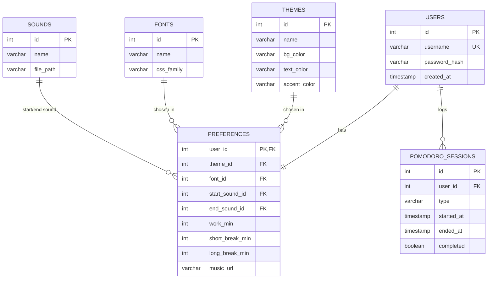
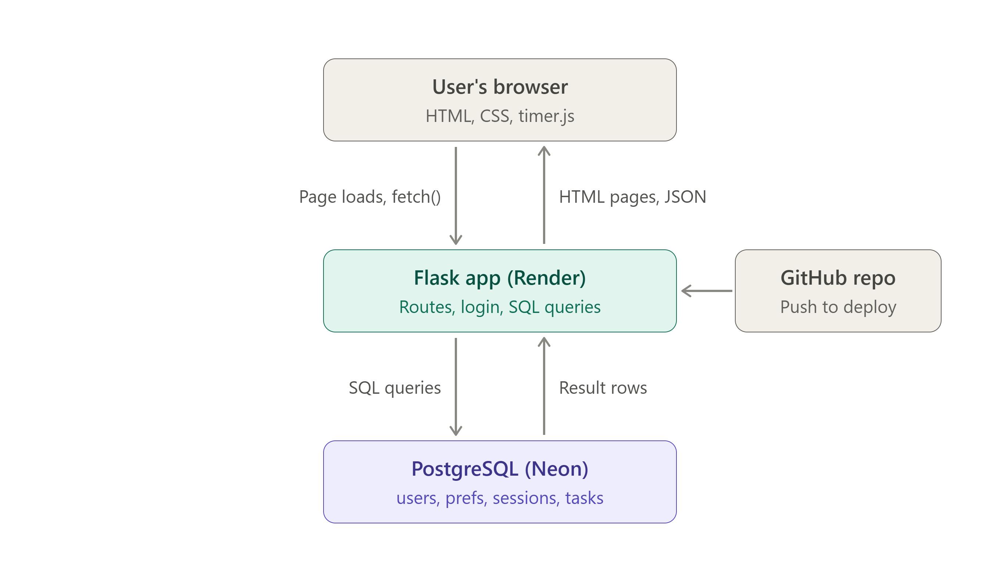

# MyPomo — A Customizable Pomodoro Timer

## Summary
MyPomo hinges on the **Pomodoro Technique**, which typically breaks work into 25-minute intervals with 5-minute breaks. In the past, I've used pomodoro timers to better manage my workflow and motivation—but I wanted more flexibility and customization options. MyPomo solves this problem by allowing users to customize their own pomodoro timer, including interval and break times, themes, and music. As a web application, MyPomo can be accessed by anyone with an internet connection. 

Supported by Flask, Neon, and PostgreSQL, MyPomo will remember user preferences through a simple login system and session management, allowing individuals to maintain their custom timers across devices and locations. MyPomo aims to benefit individuals who need additional support in their workflow management, task motivation, and more.

## ERD

## System Design

## Daily Goals
- Spend at least ~1hr developing MyPomo application
- Develop with usability in mind
- Approach MyPomo tasks strategically rather than spontaneously